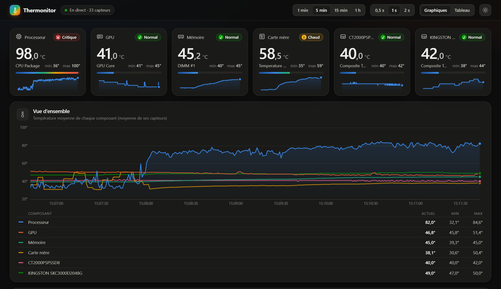
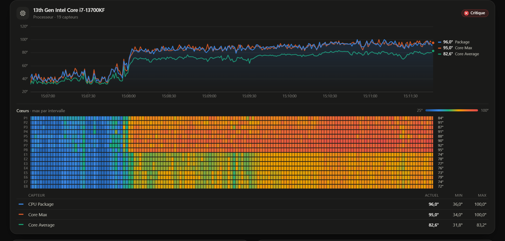
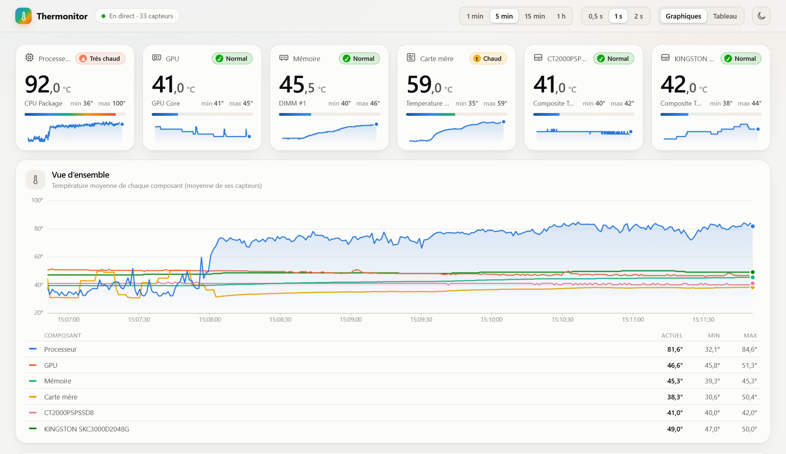
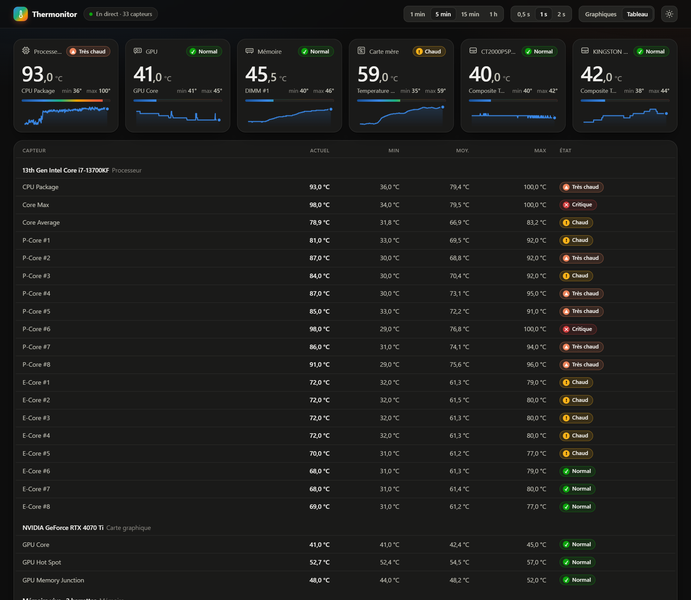

<p align="center"></p>

<p align="center">
  <a href="https://github.com/Irony42/Thermonitor/releases/latest"></a>
  <a href="https://github.com/Irony42/Thermonitor/releases/latest/download/Thermonitor-standalone.exe"></a>
  <a href="LICENSE"></a>
</p>

# Thermonitor

Petit outil Windows qui affiche en direct les températures du PC (processeur et cœurs, GPU, carte mère, mémoire, SSD), avec des graphiques. **[Télécharger](#télécharger)**

- Capteurs : [LibreHardwareMonitorLib](https://github.com/LibreHardwareMonitor/LibreHardwareMonitor) (C#, .NET 10).
- Interface : une page HTML sans dépendance. Les graphiques sont dessinés en canvas et les données arrivent en direct (Server-Sent Events).
- Tout reste en local : le serveur écoute uniquement sur `http://localhost:8787`.



*Captures prises sur un vrai PC (i7-13700KF, RTX 4070 Ti) pendant une suite de tests qui fait monter le processeur à plus de 90 °C.*

| Processeur : courbes et carte thermique des 16 cœurs | Thème clair |
|---|---|
|  |  |

<details>
<summary>Vue tableau (tous les capteurs, min / moyenne / max sur la fenêtre)</summary>



</details>

### Ce qu'on y voit

- **Tuiles** : la température la plus représentative de chaque composant, son état (Normal, Chaud, Très chaud, Critique, avec des seuils propres à chaque type de composant), une jauge et une mini-courbe.
- **Vue d'ensemble** : une courbe par composant (moyenne de ses capteurs), avec infobulle synchronisée entre tous les graphiques.
- **Une carte par composant** : courbes des capteurs, légende cliquable (masquer une courbe), min / max sur la fenêtre. Pour le processeur, une carte thermique cœur par cœur.
- **Fenêtre** de 1 min à 1 h, mesure toutes les 0,5 / 1 / 2 s, thème clair ou sombre, vue tableau.

## Télécharger

Dernière version : **[page des releases](https://github.com/Irony42/Thermonitor/releases/latest)**. Pas d'installation, l'exe se lance tel quel.

| Fichier | Taille | Pour qui |
|---|---|---|
| **[Thermonitor-standalone.exe](https://github.com/Irony42/Thermonitor/releases/latest/download/Thermonitor-standalone.exe)** | ~50 Mo | Le plus simple : rien d'autre à installer. |
| [Thermonitor.exe](https://github.com/Irony42/Thermonitor/releases/latest/download/Thermonitor.exe) | ~7 Mo | Si le runtime **.NET 10 Desktop** est installé. Sinon, Windows propose de le télécharger. |

Pour lire le **processeur, la carte mère et la mémoire**, installe aussi le pilote PawnIO (celui de LibreHardwareMonitor et FanControl). Sans lui, ou sans droits admin, seuls le GPU et les SSD sont lisibles :

```powershell
winget install namazso.PawnIO
```

L'exe n'est pas signé : au premier lancement, Windows SmartScreen peut afficher « Windows a protégé votre ordinateur ». Clique sur **Informations complémentaires**, puis sur **Exécuter quand même**. Les empreintes SHA-256 de chaque version sont dans les notes de la release.

Prérequis : Windows 10 ou 11, 64 bits. La fenêtre utilise WebView2, déjà présent dans Windows 11.

## Utilisation

1. Windows demande les droits administrateur (UAC). Seul le serveur de capteurs les reçoit, pas la fenêtre.
2. La fenêtre Thermonitor s'ouvre : une fenêtre Windows native (WebView2, le moteur d'Edge intégré à Windows), sans droits admin. Sans WebView2, l'appli se rabat sur une fenêtre Chrome ou Edge en mode application.
3. Quand la fenêtre est fermée, le serveur s'arrête aussitôt. Relancer Thermonitor alors qu'il est ouvert ramène simplement la fenêtre au premier plan. La position et la taille de la fenêtre sont mémorisées.

| Option | Effet |
|---|---|
| `--no-elevate` | ne demande pas les droits admin (mode limité) |
| `--no-window` | pas de fenêtre, serveur seul (`--no-browser` marche aussi) |
| `--keep-alive` | ne s'arrête pas quand la fenêtre est fermée |

Ses fichiers sont dans `%LOCALAPPDATA%\Thermonitor` : le journal (`thermonitor.log`), la position de la fenêtre et le cache de WebView2.

## Compiler

```powershell
winget install Microsoft.DotNet.SDK.10
dotnet publish src/Thermonitor -p:PublishProfile=SingleExe   # -> dist\Thermonitor.exe (léger, demande .NET 10 Desktop)
dotnet publish src/Thermonitor -p:PublishProfile=SingleExe -p:SelfContained=true -p:EnableCompressionInSingleFile=true -p:PublishDir=dist\standalone\   # autonome
```

## Organisation

```
src/Thermonitor/
  Program.cs            lancement : élévation UAC, serveur, fenêtre
  App/                  la fenêtre (WinForms + WebView2) et le plan de lancement (testé)
  Platform/             Windows : log, élévation, navigateur, instance déjà lancée
  Sensors/              lecture des capteurs (LibreHardwareMonitor) et filtrage des valeurs
  Feed/                 historique d'une heure, format des messages, diffusion aux pages
  Web/                  serveur HTTP local et fichiers de la page
  wwwroot/              la page : index.html, app.css, js/
    js/domain.js        logique pure (groupes, stats, échelles, couleurs) : testée sous Node
    js/feed.js          suivi du flux (instantané, ticks, purge d'une heure) : testé sous Node
    js/store.js         état partagé et boucle de rendu
    js/charts.js        graphiques canvas (courbes, carte thermique des cœurs, mini-courbes)
    js/app.js           réception des données, construction de la page
tests/Thermonitor.Tests xUnit : filtre, historique, format, hub, fichiers, serveur HTTP réel
tests/web               node:test : logique de la page
dev/mock-server.mjs     capteurs simulés pour travailler la page sans admin
```

Les données vont dans un seul sens : `LhmSensorSource` → `SensorHub` (filtre + historique) → `FeedFrames` (JSON) → `WebServer` (SSE) → `app.js`. `ISensorSource` permet de remplacer le matériel par une source factice dans les tests.

## Tests

```powershell
dotnet test Thermonitor.slnx
node --test "tests/web/*.test.mjs"     # ou : npm test
```

## Travailler la page

- `node dev/mock-server.mjs` : sert la page avec des capteurs simulés sur http://localhost:8788 (ni admin, ni .NET). Ajouter `--limited` pour voir le mode sans droits admin.
- `powershell -File dev/make-icon.ps1` : régénère l'icône de l'exe, le logo de la page et celui du README à partir de `branding/Thermonitor_logo.png`. L'icône utilise le robot et son pouce en grand, et la tête seule en 16–32 px pour rester lisible.
- `node dev/screenshots.mjs [url]` : refait les captures de ce README (Chrome headless, sans dépendance) à partir d'un Thermonitor lancé, ou du serveur simulé.
- Avec le vrai serveur : `$env:THERMONITOR_WWW = "$PWD\src\Thermonitor\wwwroot"` puis `dotnet run --project src/Thermonitor -- --no-elevate`. La page est relue depuis le disque à chaque rechargement. `--no-elevate` est nécessaire : la copie lancée en admin par l'UAC ne reçoit pas la variable d'environnement.

## Sécurité du serveur local

- Écoute sur `localhost` uniquement, et refuse tout autre nom d'hôte (protection contre le DNS rebinding).
- `/api/*` refuse les appels venant d'un autre site (`Sec-Fetch-Site`, `Origin`). Les actions (`POST`) exigent en plus l'en-tête `X-Thermonitor: 1`, qu'aucun autre site ne peut envoyer sans une autorisation CORS que le serveur ne donne jamais.
- La page ne peut pas être affichée dans une iframe (`X-Frame-Options`, CSP `frame-ancestors 'none'`) et ne charge que ses propres fichiers.

## Licence

[MIT](LICENSE). Les capteurs sont lus avec [LibreHardwareMonitorLib](https://github.com/LibreHardwareMonitor/LibreHardwareMonitor) (MPL-2.0), récupéré par NuGet et intégré tel quel à l'exe publié.
